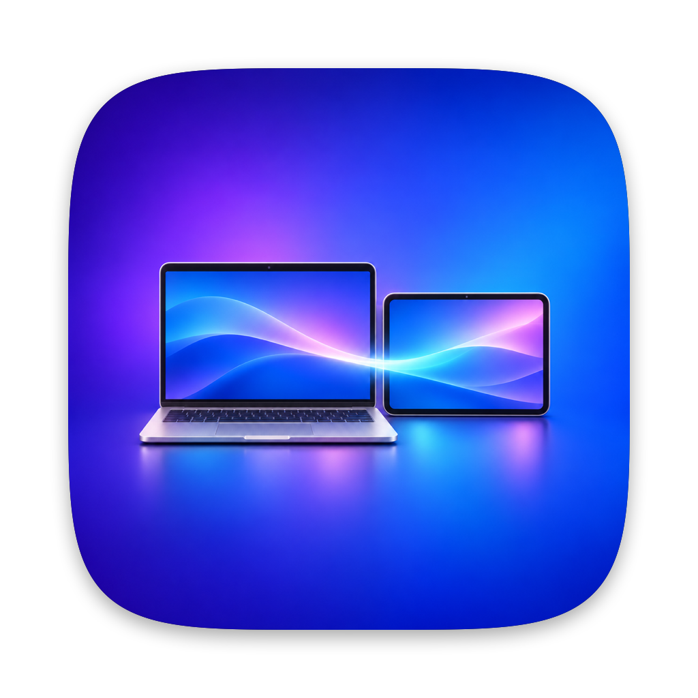

# TabScreen

Use an Android tablet or phone as a real extra display for your Mac.

macOS sees a normal second monitor: drag windows onto it, arrange it in System Settings → Displays, pick its size.
The Android device shows it full screen in the TabScreen app, over a USB cable (least lag) or over Wi-Fi.

- **A real extended display, not mirroring.** TabScreen creates a virtual monitor shaped like your device's screen:
  its resolution, shape and refresh rate, with sharp (HiDPI) "looks like" sizes.
- **Low lag.** Hardware H.264 on both sides, tuned for latency: no frame reordering, the decoder's low-latency modes,
  and every frame shown at the next screen refresh. The mouse pointer is drawn on the device, so it moves instantly.
- **Plug and play over USB.** Plug the device in and TabScreen installs and opens the app by itself.
- **Wi-Fi too**, protected by an access key.
- **Works with most Android devices**: any tablet or phone with Android 8 or newer.

## What you need
- A Mac with Apple silicon, macOS 13 or newer, and Apple's command line developer tools
  (run `xcode-select --install` in Terminal if you don't have them).
- An Android tablet or phone with Android 8 or newer. For USB, a cable that carries data.

## Build and start
1. Download this repository (green **Code** button → **Download ZIP**) and unzip it, or clone it.
2. Double-click **Build and Run.command**. A tablet icon appears in the menu bar: that's TabScreen.
3. When macOS asks, allow Screen Recording for TabScreen (System Settings → Privacy & Security →
   Screen & System Audio Recording), then choose **Restart TabScreen** from the menu bar icon.

The first build makes a signing certificate that stays on your Mac, so the permission survives later rebuilds.

## Connect over USB (recommended)
On the Android device, once:
1. Settings → About → Software information → tap **Build number** 7 times. This turns on Developer options.
2. Settings → Developer options → turn on **USB debugging**.
3. Samsung: turn off **Auto Blocker** (Settings → Security and privacy); it blocks USB commands.
   Xiaomi: also turn on **Install via USB** in Developer options.

On the Mac: menu bar icon → **Set up USB connection…** (downloads Google's `adb` tool, about 15 MB).

Plug the device in and tap **Allow** when it asks about USB debugging. TabScreen installs the TabScreen app
(the first time, and after updates) and opens it. From then on, just plug it in.

## Wi-Fi
Menu bar icon → **Allow Wi-Fi connection**. A device that has been connected over USB once already knows the Mac's
address and key: open the app and it connects. Otherwise tap **Wi-Fi settings** in the app and type the address and
key shown in the menu. Wi-Fi access switches itself off every time TabScreen starts.

There's also a browser viewer: open the **Browser** address from the menu in Chrome. Browsers only decode video on
secure pages, so on plain Wi-Fi it shows pictures instead of video.

## Adjusting
- **Screen size**: "looks like" sizes worked out from your device's physical size, from larger text to more space,
  plus pixel for pixel.
- **Picture quality**: lighter (slow Wi-Fi), balanced or sharper.
- **Arrange displays…**: put the extra display where the device sits on your desk.

The extra display takes the shape of whichever device connects, and your choices are remembered for each device.
For the smoothest picture, set the device to its highest refresh rate (Samsung: Settings → Display →
Motion smoothness → Adaptive).

## How it works
- `Sources/` is the Mac app, in Swift. It makes the extra display with macOS's private `CGVirtualDisplay` API
  (the one DeskPad and BetterDisplay use), captures it with ScreenCaptureKit, encodes it with VideoToolbox in
  low-latency mode, and sends it through a small HTTP/WebSocket server. Over USB, `adb reverse` lets the device reach
  the Mac at its own `localhost`.
- `Android/` is the TabScreen app, in plain Java with no Android Studio: MediaCodec decodes straight onto the screen.
  `Android/TabScreen.apk` is a ready-made build. To rebuild it, run `Android/build-apk.sh` on Linux (the Debian or
  Ubuntu packages it needs are listed at the top). It creates its own signing key in `Android/signing/`, which stays
  out of git.
- `Resources/viewer.html` is the browser viewer.

## Security
- In USB mode TabScreen only listens on 127.0.0.1, so nothing on your network can connect.
- Wi-Fi mode needs the access key; 5 wrong keys block that address for 10 minutes.
- Only the extra display is sent, never your other screens, and nobody can control the Mac through TabScreen.
- While the cable is plugged in, other apps on the Android device could also reach TabScreen through adb's tunnel.
  Only plug in devices you trust.

## Limitations
- It relies on a private macOS API, so a macOS update could break it.
- One extra display at a time.
- No touch input yet: the device is a screen; use the Mac's mouse and keyboard.

## If something doesn't work
TabScreen writes `TabScreen.log` next to the app (the Android app adds notes about its decoder and timing), and the
build writes `build.log`.

## License
MIT. See [LICENSE](LICENSE).
